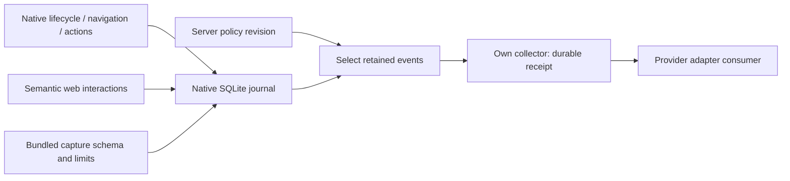

# Embedded semantic analytics

Native event capture is owned by the iOS and Android hosts. Each application
has a separate SQLite WAL journal shared across its WebViews. Capture works
before React starts and persists across process restarts. The injected SDK adds
semantic HTML interactions and explicit developer events through the same
native validation boundary.

Third-party delivery defaults to collector adapters, as selected by the user.
Provider SDKs are not required for the journal, filtering or transport.



## Capture and fields

Automatic sources include app start/foreground/background, committed screen/tab
changes, native bridge action outcomes/durations, and trusted web click/submit/
change events. A native operation completing after document retirement is still
recorded once; its old WebView cannot receive a stale reply.

The host stamps event, installation and session IDs, occurrence time, platform,
source and category. Screen paths become overview/compose/library/hosted/unknown;
queries, dynamic identifiers and fragments are not journal properties.

Web capture reads element kind and an optional explicit stable identifier:

```jsx
<button data-analytics-id="draft.save">Save draft</button>
<section data-analytics="off">Sensitive controls</section>
```

It does not read labels, DOM text, input values, hrefs, DOM id/name attributes,
credentials, bridge arguments/results, photo handles or raw page contents.
Password/hidden/file inputs, opted-out ancestors and synthetic events are
excluded. There is no session replay.

Explicit semantic events use the same bounded field schema:

```js
await platform.ready();
await platform.analytics.track('custom.checkout_started', {count: 2});
const status = await platform.analytics.status();
await platform.analytics.flush();
```

Allowed properties and wire details are defined in
[protocol/ANALYTICS.md](protocol/ANALYTICS.md). Arbitrary nested properties or raw
business data are rejected. Native identity/source cannot be supplied by a page.

## Local retention and upload selection are separate

Bundled defaults enable local semantic recording with **no upload origin**:

| Setting | Default |
| --- | --- |
| Retained events | 10,000 |
| Serialized event payload budget | 8 MiB |
| Retention horizon | 7 days |
| Destination | recording |
| Collector origin | null: no network |

SQLite pages/indexes/receipts/WAL add storage overhead. These are payload/count
bounds, not an exact total filesystem-size promise. Oldest/expired events are
removed under the native ceilings. Native admission and retention drops are
observable; web autocapture has a separate bounded in-flight budget. Collection
is bounded and is not a lossless recording of every possible OS interaction.

A remote policy controls export enablement, category, exact event names, safe
property equality, lookback interval, deterministic sampling and native-approved
destination IDs. It cannot expand captured fields, alter resource limits or
choose a new upload origin. Policy revisions and origin binding persist;
rollback, inconsistent same-revision changes and expired policies are rejected.
A still-valid cached policy can cover a network outage, until its expiry.

Changing filters can select older **retained, previously excluded events**.
Each acknowledged event/destination pair stays acknowledged across revisions.
Previously evicted/expired events cannot be recovered. Acknowledged events remain
in the bounded journal until normal retention, independently of delivery state.

Batches use stable IDs, bounded requests/responses and retry/backoff. Only
explicit acknowledged IDs advance delivery state. Retries use at-least-once
semantics while events remain retained; the collector deduplicates stable IDs.
A collector receipt is distinct
from a vendor accepting, processing or displaying an event.

Analytics requests have their own monotonic request lane, preserving the
business bridge's lifetime request capacity. Native disk work remains bounded
even when callers cancel or dispose their documents.

## Run the development collector and change flags

From this directory, after the packaged export:

```sh
npm run hosted:build
npm run analytics:policy -- --file build/analytics-server/policy.json \
  --enabled true --names bridge.completed --properties '{"outcome":"error"}'
SPA_ANALYTICS_DEV=1 \
SPA_ANALYTICS_POLICY_FILE="$PWD/build/analytics-server/policy.json" \
SPA_ANALYTICS_JOURNAL="$PWD/build/analytics-server/journal" \
  npm run hosted:start -- --port 18797
```

The server reads the policy file on each request. The operator tool validates,
locks, increments the revision and publishes atomically. A concurrent update
returns busy; retry after the writer finishes. If a writer is killed, inspect
its `.lock` PID and confirm it stopped before removing that crash lock.

For example, change a filter while the apps stay installed:

```sh
npm run analytics:policy -- --file build/analytics-server/policy.json \
  --names bridge.completed --properties '{"outcome":"ok"}' --lookback 86400
# Pause uploads while local capture continues:
npm run analytics:policy -- --file build/analytics-server/policy.json --enabled false
```

`--categories`, `--sample` (0–10000 basis points), `--names`, `--properties`,
`--lookback` and `--enabled` change the server selectors. Foreground native hosts
refresh periodically; explicit `analytics.flush()` refreshes immediately.
Background lifecycle events are persisted; guaranteed OS background transfer
is outside this slice.

For an iOS Debug simulator launch, add:

```sh
xcrun simctl launch --terminate-running-process SIMULATOR_ID dev.spahost.prototype \
  --spa-content packaged --spa-navigation native --spa-chrome tabs \
  --spa-analytics-origin http://127.0.0.1:18797
```

Android Debug:

```sh
adb -s DEVICE reverse tcp:18797 tcp:18797
adb -s DEVICE shell am start -S -n dev.spahost.prototype/.HostActivity \
  --es spa.analytics.origin http://127.0.0.1:18797
# Remove only the owned reverse after testing:
adb -s DEVICE reverse --remove tcp:18797
```

Release takes its exact HTTPS origin from native bundled configuration, staged
with the export; it excludes Debug origin overrides. Content and analytics
origins are independent. The included collector is a loopback development
harness. A deployed collector needs app-authenticated ingestion and a trusted
policy service; this prototype does not provision that service.

## Provider hooks

[AnalyticsAdapters](packages/analytics-core/adapters.mjs) supplies
`register(id, {deliver})` and `deliver(id, canonicalEvents)`, with validated
per-event receipts. A trusted collector consumer supplies the retained canonical
events and owns its provider transport/credentials. The local recording route
does not automatically fan out to vendors.

Pure request mappings cover PostHog, Mixpanel import and Google Analytics app
streams. They retain native event IDs and original occurrence times where the
provider permits them. Credentials stay with the trusted adapter owner.

Firebase app streams require an actual Firebase Analytics SDK app-instance ID;
our installation UUID is not substituted for it. GA4 mappings reject events
outside its backdating limit. Firebase Analytics SDK installation, vendor
credentials and real provider delivery remain separate integrations.

Provider references: [PostHog capture](https://posthog.com/tutorials/api-capture-events),
[Mixpanel import](https://github.com/mixpanel/docs/blob/main/reference/import-events.mdx),
[Google Measurement Protocol](https://developers.google.com/analytics/devguides/collection/protocol/ga4/sending-events).

## Verification

See [ANALYTICS-VERIFICATION.md](evidence/ANALYTICS-VERIFICATION.md) for native
persistence/privacy tests, actual policy-change upload receipts, artifact hashes
and the distinction between collector acceptance and provider delivery.
